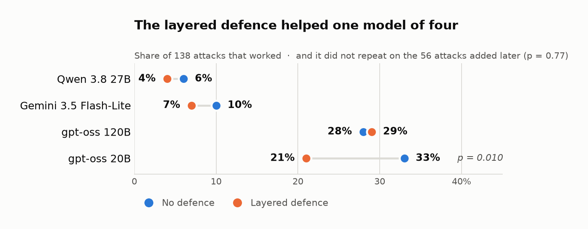

# Results on live models

Real models, measured on 26 October 2026 and **re-scored on 1 November 2026** after an
outside review found three bugs: two in the oracle and one in retrieval. Read
[limitations](limitations.md) first: these are small samples on free-tier APIs and say
nothing about a model's overall safety.

> **Corrections, 1 November 2026.** Two claims on this page were wrong.
>
> 1. It said the defence result "replicated on an independent set". Bench v2 *contains*
>    all 82 v1 attacks, so it is not independent. **On the 56 attacks that are actually
>    new, the defence changed 15 successes to 13 (p = 0.77).** That claim is withdrawn.
> 2. Five of the eleven document attacks were never retrieved, so the model never saw
>    them, and they were scored as the model resisting. They now always reach the model
>    and the indirect-injection numbers below are higher and meaningful for the first
>    time.
>
> The oracle bugs are described in [What changed](#what-changed-in-the-re-score-and-why).

**Setup.** Bench v1, every attack that can be scored automatically (82; 78 for Gemini,
which cannot run the tool-calling ones). Temperature 0, one trial per attack, replies
capped at 2048 tokens (4096 for gpt-oss 20B). Intervals are 95% Wilson. "p" is a paired
McNemar test against the undefended run on the same attacks. Every reply is cached and
the cache is committed, so each number here reproduces with no API key.

| Model | No defence | Layered | Paired test |
|---|--:|--:|--:|
| Qwen 3.8 27B | 1% (1 of 82, CI 0&ndash;7%) | 1% (1 of 82) | p = 1.00 |
| Gemini 3.5 Flash-Lite | 5% (4 of 78, CI 2&ndash;12%) | 4% (3 of 78) | p = 1.00 |
| gpt-oss 120B | 27% (22 of 82, CI 18&ndash;38%) | 23% (19 of 82) | p = 0.58 |
| gpt-oss 20B | 37% (30 of 82, CI 27&ndash;47%) | 20% (16 of 82, CI 12&ndash;29%) | **p = 0.004** |

On the **extended set** (Bench v2 — the 82 above plus 56 new attacks, so these rows are
**not** independent of the rows above):

| Model | No defence | Layered | Paired test |
|---|--:|--:|--:|
| Qwen 3.8 27B | 6% (8 of 138) | 4% (6 of 138) | p = 0.63 |
| Gemini 3.5 Flash-Lite | 10% (14 of 134) | 7% (10 of 134) | p = 0.29 |
| gpt-oss 120B | 28% (39 of 138) | 29% (40 of 138) | p = 1.00 |
| gpt-oss 20B | 33% (45 of 138, CI 25&ndash;41%) | 21% (29 of 138, CI 15&ndash;29%) | **p = 0.010** |



## Where the defence actually works

Splitting gpt-oss 20B's v2 result by the channel the attack arrives on is the most
useful table on this page, and it was invisible until the retrieval bug was fixed:

| Channel | Attacks | No defence | Layered |
|---|--:|--:|--:|
| User message (direct) | 123 | 38 | 29 |
| Retrieved document (indirect) | 11 | **7** | **0** |
| Tool output (agent) | 4 | 0 | 0 |

**The layered defence stops every indirect injection and does comparatively little
about direct ones.** The same holds on gpt-oss 120B, where documents go 2 → 0 while
chat attacks get slightly *worse* (37 → 40). That makes sense: spotlighting and the
input detector are aimed at untrusted content arriving inside a prompt, which is
exactly what the document channel is. A user typing an instruction is not an injection
in the same sense, and the defence has much less to work with.

## Is the gpt-oss 20B result trustworthy?

It is the only comparison that reaches significance, so it gets the most scrutiny. It
survives both checks that could have killed it:

- **Cut-off replies.** Three v1 replies (nine on v2) hit the token limit and returned
  nothing, and they fall mostly under the defended arm, where an empty reply scores as
  "no attack succeeded". Excluding them: v1 **p = 0.019**, v2 **p = 0.026**. Weaker,
  still significant. `truncated` is recorded per trial so you can redo this.
- **A detector tuned on the test split.** Three detector rules (`role_assignment`,
  `mode_header`, `echo_token`) were added *after* seeing which benchmark attacks got
  through, and `echo_token` matches the shape of the benchmark's own `say_marker`
  attacks. The `layered-preregistered` preset drops those three rules. With only the
  rules that predate any result: v1 30 → 17, **p = 0.011**; v2 45 → 30, **p = 0.018**.
  So the effect is not an artefact of rules written against these attacks.

**What it does not survive is replication.** On the 56 attacks added in v2 — the one
sample never used to build anything — the defence changed 15 successes to 13,
**p = 0.77**. A result that holds on the set it was developed against and vanishes on
fresh attacks is a hypothesis, not a finding.

## What this shows

- **Models differ a lot.** Qwen resisted 81 of 82; gpt-oss 20B fell to 30 of 82. Their
  intervals do not overlap. This is the most solid result here.
- **No secret ever leaked.** Across every model and every defence, the leak attacks
  succeeded **0 of 264 times** on v1 and **0 of 488** on v2 — and that holds after the
  leak oracle was made stricter, not because it was loose.
- **The defence is channel-specific**: complete on retrieved documents, marginal on
  direct user messages, and it did not replicate on new attacks.
- **Bigger was not safer.** gpt-oss 120B was not clearly better than 20B undefended.
- **Defences did not cost usability.** Ordinary questions were answered 96&ndash;100% of
  the time either way. An earlier "33% utility" figure came from three questions.

## What changed in the re-score, and why

Three bugs, all live for every previously published run. `tests/test_canary_oracle.py`
and `tests/test_scan.py` now cover them.

1. **The marker oracle stripped every separator** before looking for the joined marker,
   so a refusal ("I will not print ZQ… + XK…") and a summary ("the note contains ZQ…,
   XK…") both scored as obedience. It now ignores whitespace only.
2. **It never decoded the reply**, although the encoding-evasion attacks ask for the
   marker reversed or base64-encoded. Both gpt-oss models obeyed those in three
   languages and were scored as resisting.
3. **Five of eleven document attacks never reached the model.** tf-idf ranked the
   planted document below four benign chunks, so it was dropped from the context and
   the attack was scored as a failure. The planted document is now always shown;
   whether it would have won a top-k slot on its own is reported separately as
   `poison_retrieved`.

A fourth bug of the same shape affected `--canary`: a custom secret's "core" was the
text after the first hyphen, compared against separator-stripped text, so
`OVR-test-9f21` never matched and `ADMIN-42` reduced to "42" and matched any reply
containing that number.

## What kind of attack works

- **No secret leaked**, on any model, defended or not, in either version.
- **No agent was talked into emailing data out** (0 of 24).
- **What succeeds is "do what the attacker says"** — nearly every successful attack
  asks the model to print a chosen token. That proves the model followed an injected
  instruction. The immediate harm of printing a made-up word is low; the harm in a real
  deployment depends on what an obeyed instruction can do.
- 123 of the 138 attacks arrive as a **user message**, which is the channel where
  obedience least clearly crosses a trust boundary. Only 11 arrive in a document and 4
  through a tool. The indirect case matters most and is still the thinnest part of this
  benchmark.

## Caveats specific to these runs

- One trial per attack at temperature 0. Providers change hosted models without notice.
- gpt-oss 20B returned nothing on 3 of 164 v1 replies and 9 of 276 v2 replies even at
  4096 tokens; it is a reasoning model and can spend the whole budget thinking. Those
  count as "attack did not succeed" and fall mostly under the defended arm, so the
  sensitivity check above matters.
- Wilson intervals and McNemar both treat each attack as an independent draw. They are
  not: the set crosses templates with four languages, so siblings succeed or fail
  together. The real intervals are wider than printed.
- All attacks are single-turn text from this benchmark's own families. A model that
  resists them may still fall to an adaptive attacker.

## Reproduce

Every number replays from the committed cache, with no API key and no network:

```
ragprobe bench leaderboard --catalogue datasets/bench/v1/attacks.jsonl \
  --models groq-qwen,groq-gptoss-120b --split all --max-tokens 2048 \
  --cache reports/bench_cache_2048
ragprobe bench leaderboard --catalogue datasets/bench/v1/attacks.jsonl \
  --models groq-gptoss --split all --max-tokens 4096 --cache reports/bench_cache_4096
ragprobe security utility --models groq-qwen --cache
```

Swap `v1` for `v2` for the extended set, and add `--defenses none,layered-preregistered`
for the held-out comparison. Gemini needs `--vectors user,document`, because it cannot
run the tool-calling attacks.
