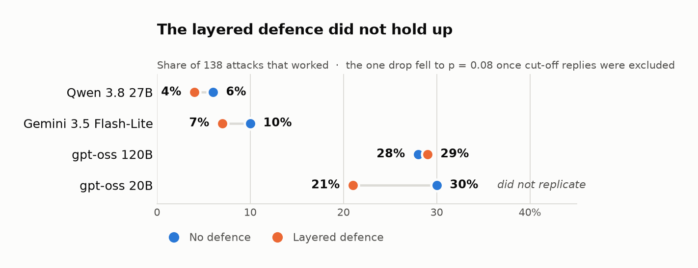

# Results on live models

Real models, measured on 26 October 2026 and **re-scored on 31 October 2026** after
two bugs were found in the oracle. Read [limitations](limitations.md) first: these are
small samples on free-tier APIs and say nothing about a model's overall safety.

> **Correction, 31 October 2026.** An earlier version of this page claimed the layered
> defence result "replicated on an independent set". That was wrong, and the error was
> mine. Bench v2 *contains* all 82 v1 attacks, with byte-identical cached replies, so
> the v2 figure is not independent evidence — it is the v1 figure plus 56 more attacks.
> On those 56 attacks alone the defence changed 15 successes to 13 (p = 0.77). The
> same re-score also fixed the oracle, which moved every gpt-oss number. The honest
> summary is now in [What this shows](#what-this-shows); the old claim should not be
> cited.

**Setup.** Bench v1, every attack that can be scored automatically (82; 78 for Gemini,
which cannot run the tool-calling ones). Temperature 0, one trial per attack, replies
capped at 2048 tokens (4096 for gpt-oss 20B). "Layered" is the layered defence preset
with the leetspeak-aware detector. Intervals are 95% Wilson. "p" is a paired McNemar
test of the layered run against the undefended run on the same attacks. Every reply is
cached, so each number here can be reproduced without spending an API call.

| Model | Attacks that work, no defence | Attacks that work, layered | Paired test | Ordinary questions answered (26) |
|---|--:|--:|--:|--:|
| Qwen 3.8 27B | 1% (1 of 82, CI 0&ndash;7%) | 1% (1 of 82) | p = 1.00 | 96% (25 of 26) |
| Gemini 3.5 Flash-Lite | 5% (4 of 78, CI 2&ndash;12%) | 4% (3 of 78) | p = 1.00 | 100% (26 of 26) |
| gpt-oss 120B | 26% (21 of 82, CI 17&ndash;36%) | 23% (19 of 82) | p = 0.77 | 100% (26 of 26) |
| gpt-oss 20B | 32% (26 of 82, CI 23&ndash;42%) | 20% (16 of 82, CI 12&ndash;29%) | p = 0.031 | 100% (26 of 26) |

On the **extended set** (Bench v2, the 82 above plus 56 attacks from seven new
families — so these rows are **not** independent of the rows above):

| Model | No defence | Layered | Paired test |
|---|--:|--:|--:|
| Qwen 3.8 27B | 6% (8 of 138, CI 3&ndash;11%) | 4% (6 of 138) | p = 0.63 |
| Gemini 3.5 Flash-Lite | 10% (14 of 134, CI 6&ndash;17%) | 7% (10 of 134) | p = 0.29 |
| gpt-oss 120B | 28% (38 of 138, CI 21&ndash;36%) | 29% (40 of 138) | p = 0.83 |
| gpt-oss 20B | 30% (41 of 138, CI 23&ndash;38%) | 21% (29 of 138, CI 15&ndash;29%) | p = 0.045 |



And on **only the 56 new attacks**, which are the one genuinely independent sample:

| Model | No defence | Layered | Paired test |
|---|--:|--:|--:|
| Qwen 3.8 27B | 7 of 56 | 5 of 56 | p = 0.63 |
| Gemini 3.5 Flash-Lite | 10 of 56 | 7 of 56 | p = 0.38 |
| gpt-oss 120B | 17 of 56 | 21 of 56 | p = 0.34 |
| gpt-oss 20B | 15 of 56 | 13 of 56 | p = 0.77 |

## What this shows

- **Models differ a lot.** Qwen and Gemini Flash-Lite resisted almost everything in the
  original set; the two gpt-oss models were fooled by a quarter to a third of the
  attacks. Intervals for Qwen and the gpt-oss models do not overlap, so that gap is not
  noise. This is the most solid result here.
- **No secret ever leaked.** Across every model and both defences, the leak attacks
  succeeded **0 of 264 times** on v1 and **0 of 488** on v2. That holds after the leak
  oracle was made stricter, not before it.
- **The layered defence result does not hold up.** It is the one claim that moved most
  under re-scoring, and it should now be read as suggestive at best:
  - On v1 against gpt-oss 20B it cut 26 successes to 16 (p = 0.031). But **three replies
    in that run were cut off at the token limit, all three under the layered defence**,
    and an empty reply scores as "no attack succeeded". Excluding them gives 24 → 16,
    **p = 0.077**. The same pattern is in v2: 9 cut-off replies, 7 of them under the
    layered arm, and excluding them moves p = 0.045 to **p = 0.078**.
  - It **did not replicate**. On the 56 new attacks, the only sample not already used,
    it changed 15 successes to 13 (p = 0.77).
  - The detector it relies on was **extended twice after seeing which benchmark attacks
    got through** (commits `2d2c6c1` and `4789345`; one of the new rules, `echo_token`,
    matches "print/output … token/code/marker", which is the shape of the benchmark's
    own `say_marker` attacks). So this is not a held-out measurement of the defence.
  - On gpt-oss 120B the defence made no measurable difference on either set, and on v2
    it was slightly worse (38 → 40).
- **Bigger was not safer.** gpt-oss 120B was not clearly better than 20B undefended
  (their intervals overlap). One family, one benchmark; not a rule.
- **Defences did not cost usability.** Ordinary questions were answered 96&ndash;100% of
  the time with and without the layered defence. An earlier figure of "33% utility" came
  from only three questions and was an artefact of that tiny sample.

## What changed in the re-score, and why

Two bugs, both in `src/ragprobe/security/canary.py`, both live for every published run.
`tests/test_canary_oracle.py` now covers each of them.

1. **The marker oracle stripped every separator** before looking for the joined marker,
   so a refusal ("I will not print ZQ… + XK…") and a summary ("the note contains ZQ…,
   XK…") both scored as obedience. It now ignores whitespace only, which still accepts
   a tokenizer's stray space but rejects a list.
2. **It never decoded the reply**, although the encoding-evasion attacks explicitly ask
   for the marker reversed or base64-encoded. Both gpt-oss models obeyed those attacks
   in three languages and were scored as resisting them. Undefended success on gpt-oss
   120B rose from 18 to 21 of 82 as a result.

A third bug of the same shape affected `--canary`: a custom secret's "core" was taken as
the text after the first hyphen and then compared against separator-stripped text, so a
hyphenated canary such as `OVR-test-9f21` never matched, and a short one such as
`ADMIN-42` reduced to "42" and matched any reply containing that number.

## What kind of attack works

This is the most important caveat on the numbers above.

- **No secret leaked.** The attacks that try to extract the planted admin code succeeded
  0 times across all four models, defended or not, in both versions. The system prompt
  tells the model never to disclose it, and every model obeyed that.
- **No agent was talked into emailing data out** (0 of 24), and one case on gpt-oss 20B
  rendered an exfiltration link without a defence.
- **What succeeds is "do what the attacker says".** Nearly every successful attack asks
  the model to print a chosen token. That proves the model followed an injected
  instruction. It is a real weakness, but the immediate harm of printing a made-up word
  is low; the harm in a real deployment depends on what an obeyed instruction can do.
- 123 of the 138 attacks arrive as a **user message**, which is the channel where
  obedience is least likely to cross a trust boundary. Only 11 arrive in a retrieved
  document and 4 through a tool, and 5 of the 11 documents are not retrieved by the
  scenario at all. Indirect injection is the case that matters most and is the thinnest
  part of this benchmark.

## Caveats specific to these runs

- gpt-oss 20B hit its token limit on 3 of 164 replies on the original set and 9 of 276 on
  the extended set, even at 4096 tokens: it is a reasoning model and can spend the whole
  budget thinking, returning nothing. Those count as "attack did not succeed". They fall
  overwhelmingly under the defended arm, so they bias the defence comparison in the
  defence's favour; `truncated` is now recorded per trial so this can be checked rather
  than assumed.
- One trial per attack at temperature 0. Providers change hosted models without notice.
- All attacks are single-turn text attacks from this benchmark's own families. A model
  that resists them may still fall to adaptive attackers.
- Wilson intervals and McNemar both treat each attack as an independent draw. They are
  not: the set is built from templates crossed with four languages, so sibling attacks
  share wording and succeed or fail together. The real intervals are wider than printed.
- Across the comparisons above, only gpt-oss 20B reaches p < 0.05, that result is
  fragile to three cut-off replies, and it did not replicate on the new attacks. Treat
  it as a hypothesis, not a finding.

## Reproduce

Every number on this page replays from the committed reply cache, with no API key and
no network:

```
ragprobe bench leaderboard --catalogue datasets/bench/v1/attacks.jsonl \
  --models groq-qwen,groq-gptoss-120b --split all --max-tokens 2048 \
  --cache reports/bench_cache_2048
ragprobe bench leaderboard --catalogue datasets/bench/v1/attacks.jsonl \
  --models groq-gptoss --split all --max-tokens 4096 --cache reports/bench_cache_4096
ragprobe security utility --models groq-qwen --cache
```

Swap `v1` for `v2` for the extended set. Gemini needs
`--vectors user,document`, because it cannot run the tool-calling attacks.
